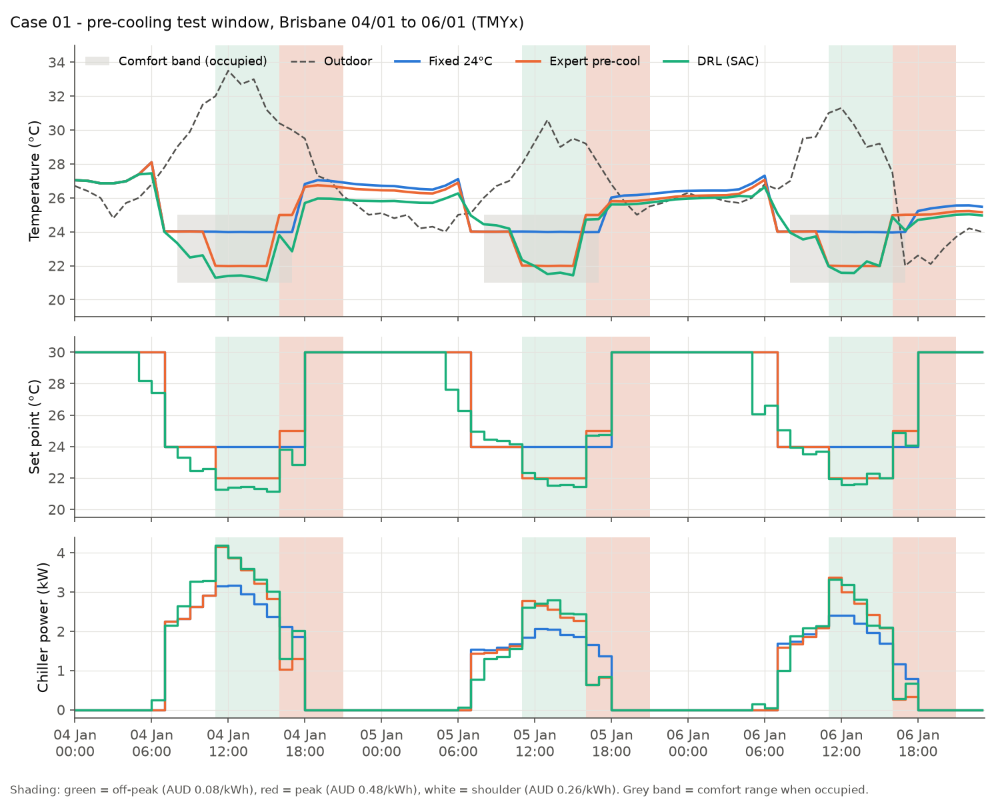
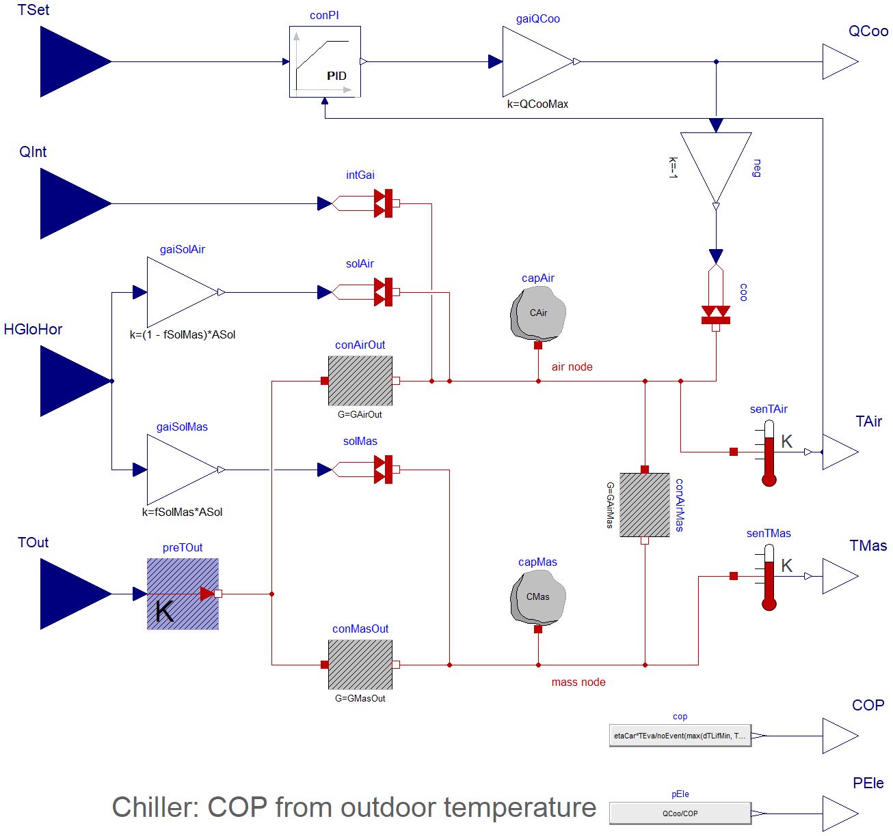
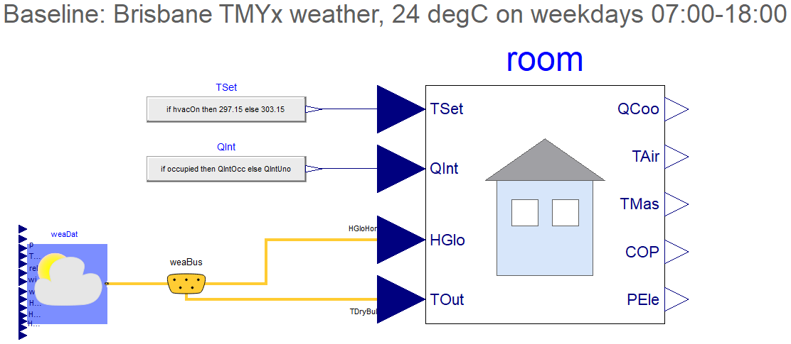
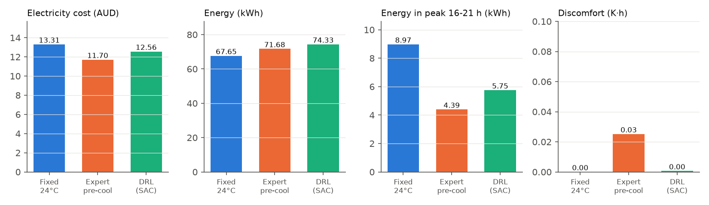
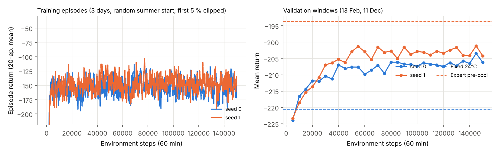
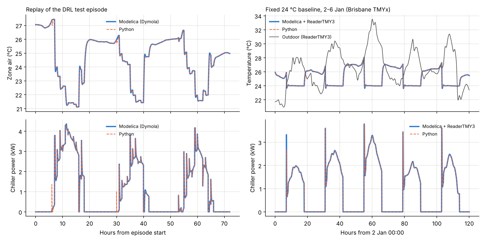

# Case 01 — Pre-cooling an office under a time-of-use tariff (Modelica + DRL)

**Can a reinforcement-learning agent learn to pre-cool a building on its own?**
A soft actor-critic (SAC) agent controls the zone set point of a small office in
Brisbane during the three hottest consecutive weekdays of a typical summer. With
no rules given to it, it learns to switch the plant off at night, to store
cooling in the building mass during the cheap midday window and to let the zone
float in the evening peak. It cuts the electricity bill by **5.6 %** versus a
fixed 24 °C schedule — but a hand-tuned pre-cooling rule still does better
(**12.0 %**). Both results are reported, with the reasons for the gap.



---

## 1. Problem

| | |
|---|---|
| Building | 100 m² office zone, two-node RC model (air + building mass) |
| Plant | Ideal chiller, COP = 0.35 · T<sub>eva</sub> / (T<sub>out</sub> + 10 K − T<sub>eva</sub>), 12 kW cooling capacity, local PI loop on zone air temperature |
| Climate | Brisbane Airport TMYx 2011–2025 (climate.onebuilding.org) |
| Tariff | Energex (SEQ) time-of-use structure: off-peak 11:00–16:00, peak 16:00–21:00, shoulder otherwise. Illustrative prices AUD 0.08 / 0.48 / 0.26 per kWh |
| Occupancy | Weekdays 08:00–18:00, comfort band 21–25 °C |
| Test window | 4–6 Jan (Wed–Fri): hottest three consecutive weekdays of Dec–Feb, outdoor max 33.5 °C |
| Validation windows | 13 Feb and 11 Dec (3 days each), used to select the best checkpoint |
| Training | Random 3-day windows starting on weekdays, Nov to mid-March, test/validation days excluded |

**Baselines**

* *Fixed 24 °C* — typical operation: 24 °C from 07:00 to 18:00 on weekdays, plant off otherwise.
* *Expert pre-cool* — hand-written rule: 24 °C from 07:00, 22 °C in the off-peak window, 25 °C from 16:00.

## 2. Modelica model

The plant is written in Modelica with the [Modelica Buildings Library 12.0.0](https://simulationresearch.lbl.gov/modelica/)
(CDL PI controller, weather reader) and the Modelica Standard Library 4.0.0:

| `HVACDRL.Case01.RCRoom` (plant, exported as FMU) | `HVACDRL.Case01.RCRoomBrisbane` (baseline with weather) |
|---|---|
|  |  |

`HVACDRL.Case01.RCRoomReplay` replays inputs logged by the Python plant,
which is how the two implementations were compared (section 5).

## 3. RL formulation

| | |
|---|---|
| Decision step | 1 h, weekdays 05:00–18:00 (outside this window the BMS keeps the plant off) |
| Action | Zone set point, 20–30 °C (continuous) |
| Observation (13) | Zone air and slab temperature, outdoor temperature (now and +3 h), solar irradiation, hour of day (sin/cos), occupancy, price, hours to peak, hours to occupancy, previous action, weekday flag |
| Reward | −(electricity cost + 2 AUD/K·h × discomfort + 0.01 AUD/K × set-point change), scaled ×20 |
| Algorithm | SAC (Stable-Baselines3), 2×128 MLP, γ = 0.95, 150 000 steps, 2 seeds |
| Training time | 24 min on a laptop CPU (both seeds in parallel) |

The Python plant (`rc_model.py`) integrates the same equations as the Modelica
model with a 30 s step and simulates a 3-day episode in about 0.1 s, which is what
makes training on a laptop practical.

## 4. Results (test window, 4–6 Jan)



| Controller | Cost (AUD) | Saving vs fixed | Energy (kWh) | Peak-period energy (kWh) | Discomfort (K·h) |
|---|---:|---:|---:|---:|---:|
| Fixed 24 °C | 13.31 | — | 67.7 | 8.97 | 0.00 |
| Expert pre-cool | **11.70** | **12.0 %** | 71.7 | **4.39** | 0.03 |
| DRL (SAC, best seed on validation) | 12.56 | 5.6 % | 74.3 | 5.75 | 0.00 |
| DRL (other seed) | 12.46 | 6.4 % | 73.1 | 5.39 | 0.21 |

Pre-cooling increases total energy use in every case — the point is to move
consumption out of the peak, not to reduce it.

**What the agent learned** — from the reward signal only:
switching the plant off at night, starting at 05:00–07:00 on hot mornings,
pulling the zone down to about 21.5 °C during the off-peak window (deeper than
the expert rule) and releasing it in the peak, with smooth set-point changes and
practically no comfort violations.

**Where it loses to the expert rule.** Of the AUD 0.86 gap, AUD 0.65 is spent in
the 16:00–18:00 peak: on the hottest afternoon the agent lowers the set point
again at 17:00 instead of letting the zone float to 25 °C. A grid search over
108 simple time-of-day rules (selected on the validation windows) reaches
AUD 10.95 (−17.7 %, discomfort 0.22 K·h) on the test window, so the room for
improvement is real.



Validation return plateaus after about 60 000 steps at −201 (best seed); the
expert rule scores −194 and the fixed schedule −221 on the same windows.

### What changed the result during development

| Change | Effect |
|---|---|
| 15 min → 1 h decision step, γ 0.99 → 0.95 | Agent stopped chattering and started to learn the daily pattern |
| Slab temperature added to the observation | The agent can see how much cooling is stored in the mass |
| Agent restricted to 05:00–18:00 on weekdays | Removed night-time operation at shoulder prices |
| Reward scaled ×20 | Per-step costs are only ~AUD 0.05; without scaling the entropy term dominated SAC |

## 5. Model validation (Modelica vs Python)



| Check | Zone air RMSE | Energy, Modelica vs Python |
|---|---:|---:|
| Replay of the DRL test episode (`RCRoomReplay`, same inputs and initial state) | **0.04 K** | 74.30 vs 74.33 kWh (0.05 %) |
| Fixed schedule 2–6 Jan with the Buildings weather reader (`RCRoomBrisbane`) | **0.02 K** | 109.16 vs 109.03 kWh (0.1 %) |

So the policy trained on the Python plant gives the same result on the Modelica
model. Matching the solar timing of `ReaderTMY3` (radiation shifted 30 min
earlier) reduced the baseline RMSE from 0.18 K to 0.02 K.

## 6. How to use

```bash
pip install -r ../../requirements.txt

# Run the trained agent (or a baseline) on the test window and print the KPIs
python run_policy.py                      # SAC, 4-6 Jan
python run_policy.py --policy expert      # expert rule
python run_policy.py --start-day 43       # SAC on another window (day of year)

# Train your own agent (about 10 min per seed on a laptop CPU)
python train.py --steps 150000 --seed 0
python run_policy.py --model results/sac_case01_seed0.zip
```

The Modelica package is in [`modelica/HVACDRL`](../../modelica/HVACDRL) (open
`package.mo` in Dymola or OpenModelica together with Buildings 12.0.0). The
plant is also provided as an FMU, so it can be simulated without a Modelica
tool, e.g. with [fmpy](https://github.com/CATIA-Systems/FMPy).

| File | Content |
|---|---|
| `config.py` | Plant parameters, scenario, tariff, reward weights |
| `rc_model.py` | Python implementation of the Modelica plant |
| `env.py` | Gymnasium environment |
| `baselines.py` | Fixed and expert controllers |
| `train.py` | SAC training template |
| `run_policy.py` | Run a trained policy or a baseline, print KPIs, plot |
| `results/` | Trained SAC models (2 seeds), KPIs, figures |
| `fmu/Case01_RCRoom.fmu` | Plant as FMU (FMI 2.0 co-simulation, win64, exported from Dymola 2023) |

## 7. Limitations

* One zone, two thermal nodes, ideal chiller: the model is deliberately small so
  that training takes minutes. Absolute numbers are indicative only.
* Perfect weather forecast (+3 h) and a perfect slab temperature measurement.
* Tariff prices are illustrative; real small-business tariffs also include
  demand charges (see Case 04).
* Single test window of three days; the result for a whole summer may differ.
* The DRL agent is trained on the Python plant; the Modelica model is used to
  verify that both implementations agree, not for training.
