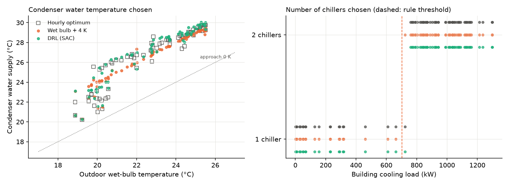
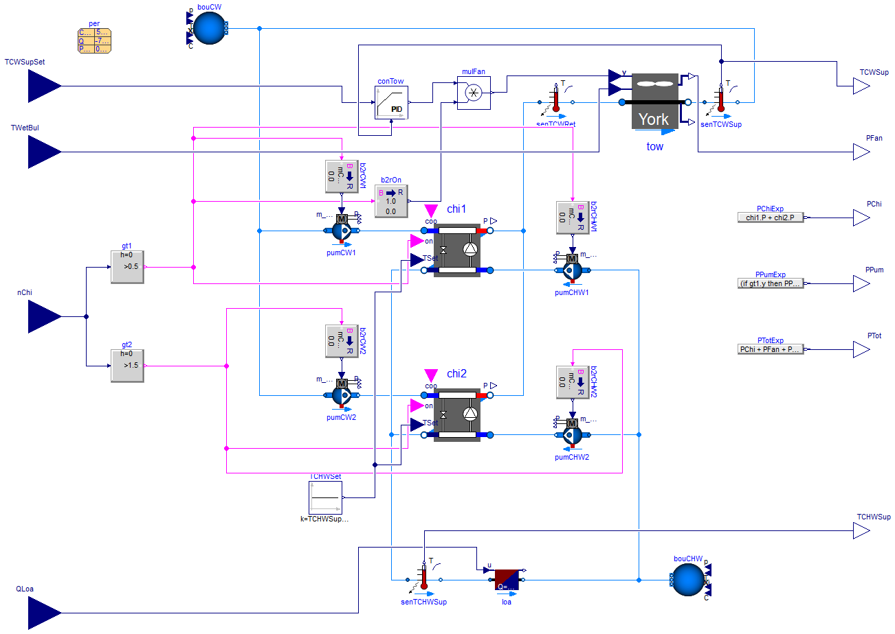
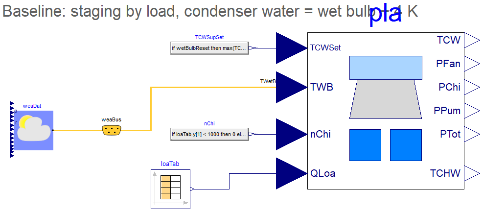
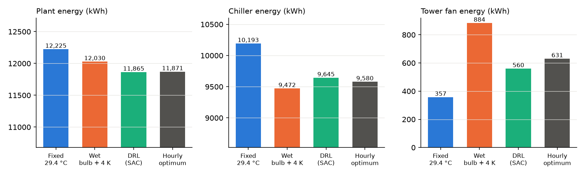
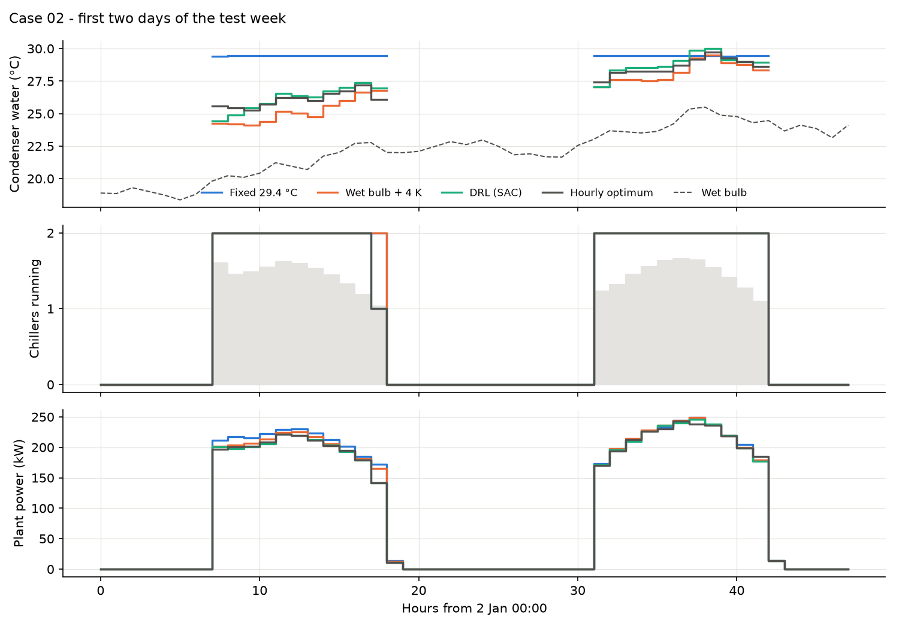
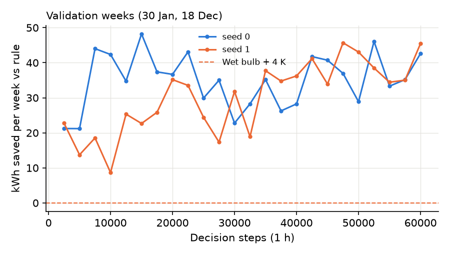

# Case 02 — Chiller staging and condenser water reset, trained directly on a Modelica FMU

**Can a reinforcement-learning agent rediscover how to run a chiller plant?**
A soft actor-critic (SAC) agent decides every hour how many of two chillers run
and which condenser water temperature the cooling tower should deliver. It is
trained **directly on the plant FMU exported from the Modelica model** — every step of every
episode is the Modelica model. Without being given any rule, it learns to follow
the outdoor wet-bulb temperature with a ~4 K approach and to bring on the second
chiller at about 720 kW — the same logic as the industry rule of thumb — and
it matches an hourly brute-force optimum. Over the test week it uses
**2.9 % less energy than a fixed 29.4 °C set point** and **1.4 % less than the
wet-bulb reset rule**.



The honest headline is that a well-tuned rule is already close to optimal for
this plant: the whole margin between the rule and the hourly optimum is about
1 %. The agent finds that margin on its own.

---

## 1. Problem

| | |
|---|---|
| Building | 15 000 m² office in Brisbane — the zone of [Case 01](../01-precooling-rc-room/) scaled up; peak load 1.35 MW, occupied hours on weekdays 07:00–18:00 |
| Chillers | 2 × water-cooled screw chillers, York YS 781 kW, COP 5.42 (performance curves from the Buildings library; valid for condenser water 15.6–35 °C) |
| Cooling tower | One variable-speed tower (YorkCalc), 30 kW fan, sized for both chillers; a PI loop modulates the fan to track the condenser water set point |
| Pumps | One constant-speed chilled water pump (5.4 kW) and condenser water pump (8.1 kW) per chiller, switched with the chiller |
| Chilled water | 6.67 °C supply |
| Climate | Brisbane Airport TMYx 2011–2025, wet-bulb temperature from the weather reader |
| Test week | 2–8 January (highest weekly load of the summer, 55 MWh) |
| Validation weeks | 30 January and 18 December (high wet-bulb weeks) |
| Training | The other 18 summer weeks (November to March), load randomly scaled by ±15 % |

**Baselines**

* *Fixed 29.4 °C* — condenser water at the design value of the chiller curves; second chiller above 90 % of one chiller's capacity.
* *Wet bulb + 4 K* — condenser water set point = outdoor wet bulb + 4 K approach (not below 18 °C); same staging. A grid search over approaches of 1–6 K and staging thresholds of 30–90 % on the validation weeks selected exactly these values, so this is a tuned rule.
* *Hourly optimum* — for every hour, all combinations of 1–2 chillers × set points 18–32 °C (0.25 K steps) are evaluated on a quasi-steady Python approximation of the plant (`plant_twin.py`), and the best one is then applied to the FMU. Because the plant has no storage, hours are independent and this is a near-optimal reference; it is not guaranteed to be the exact optimum of the FMU.

## 2. Modelica model

| `HVACDRL.Case02.ChillerPlant` (exported as FMU) | `HVACDRL.Case02.ChillerPlantBrisbane` (weather, load, baseline) |
|---|---|
|  |  |

Inputs of the plant: number of chillers, condenser water set point, wet-bulb
temperature, building load. Outputs: chiller, fan, pump and total power,
condenser and chilled water supply temperatures.

**FMU check.** Running the FMU from Python with the wet-bulb rule for the test
week gives 12 011 kWh, against 11 966 kWh for the same rule simulated directly in Modelica
(0.4 %; the difference comes from updating the set point hourly instead of
continuously). One hourly step of the FMU takes 0.6 ms on a laptop.

## 3. RL formulation

| | |
|---|---|
| Plant in the loop | The plant FMU (FMI 2.0 co-simulation) via fmpy, 10 min communication step |
| Decision step | 1 h, only hours with cooling load (≈ 55–72 per week) |
| Action (2, continuous) | Condenser water set point 18–32 °C; staging signal (> 0 → 2 chillers) |
| Safety layer | The second chiller is forced on above 95 % of one chiller's nominal capacity |
| Observation (10) | Load now and +1 h, wet bulb now and +1 h, dry bulb, hour of day (sin/cos), previous set point, previous staging, measured condenser water temperature |
| Reward | −[(E − E<sub>rule</sub>) / 2 kWh + 5 × unmet K·h + 0.5 × staging changes] |
| Algorithm | SAC (Stable-Baselines3), γ = 0.9, 60 000 steps, 2 seeds |
| Training time | 11 min on a laptop CPU (both seeds in parallel) |

**Why the reward subtracts the rule's energy.** The plant uses 100–250 kWh per
hour, but the best and the worst sensible decision differ by only a few kWh.
With the raw energy as reward the agent could not see the effect of its
actions (it learned a nearly constant set point). E<sub>rule</sub> — the energy
the wet-bulb rule would use in that hour, estimated with `plant_twin.py` —
depends only on load and weather, which the agent cannot influence, so
subtracting it does not change the optimal policy; it only removes the large,
load-driven variation of the reward.

## 4. Results (test week, 2–8 January, on the FMU)



| Controller | Energy (kWh) | vs fixed | vs rule | Chillers (kWh) | Tower fan (kWh) | Pumps (kWh) | Unmet (K·h) |
|---|---:|---:|---:|---:|---:|---:|---:|
| Fixed 29.4 °C | 12 225 | — | −1.6 % | 10 193 | 357 | 1 674 | 0 |
| Wet bulb + 4 K | 12 030 | 1.6 % | — | 9 472 | 884 | 1 674 | 0 |
| **DRL (SAC)** | **11 865** | **2.9 %** | **1.4 %** | 9 645 | 560 | 1 661 | 0 |
| Hourly optimum | 11 871 | 2.9 % | 1.3 % | 9 580 | 631 | 1 661 | 0 |

The two training seeds reach 11 865 and 11 878 kWh.

**What the agent learned.**
*Condenser water:* it follows the wet bulb with a mean approach of 4.2 K. At low
wet-bulb temperatures it keeps the condenser water warmer than the rule: the
chillers use slightly more energy (+1.8 %), but the tower fan, whose power
grows with the cube of its speed, uses 37 % less.
*Staging:* it starts the second chiller at about 720 kW (rule: 703 kW) and drops
back to one chiller in the last occupied hour, as the hourly optimum does.





On the validation weeks the final agents save about 40–45 kWh per week
relative to the rule.

## 5. How to use

```bash
pip install -r ../../requirements.txt

# Run the trained agent (or a rule) on the plant FMU for one week
python run_policy.py                      # SAC, test week
python run_policy.py --policy rule        # wet bulb + 4 K
python run_policy.py --start-day 29       # another week (day of year of a Monday)

# Train your own agent on the FMU (about 10 min per seed)
python train.py --steps 60000 --seed 0
```

The FMU contains Windows 64-bit binaries. On other platforms set
`HVACDRL_PLANT=twin` to use the quasi-steady Python approximation instead
(it reproduces the FMU's weekly energy within about 1 %).

| File | Content |
|---|---|
| `config.py` | Plant data, scenario, reward weights |
| `env.py` | Gymnasium environment around the FMU |
| `baselines.py`, `rules.py` | Rule-based staging and set point, episode runner and KPIs |
| `plant_twin.py` | Quasi-steady approximation (reward reference, non-Windows runs, hourly optimum) |
| `train.py` | SAC training template |
| `run_policy.py` | Run a trained policy or a rule on the FMU and print KPIs |
| `results/` | Trained SAC models (2 seeds), KPIs, figures |
| `fmu/Case02_ChillerPlant.fmu` | Plant as FMU (FMI 2.0 co-simulation, win64) |

## 6. Limitations

* Constant-speed pumps and a single tower cell: with variable-speed pumps or
  several tower cells the rule would leave more on the table.
* No thermal storage, so hours are independent and the problem is close to a
  static optimisation; a well-tuned rule is already within about 1 % of the optimum.
* Perfect one-hour forecasts of load and wet bulb.
* The load comes from a single scaled zone model, not a full building simulation.
* One test week; seasonal results may differ.
