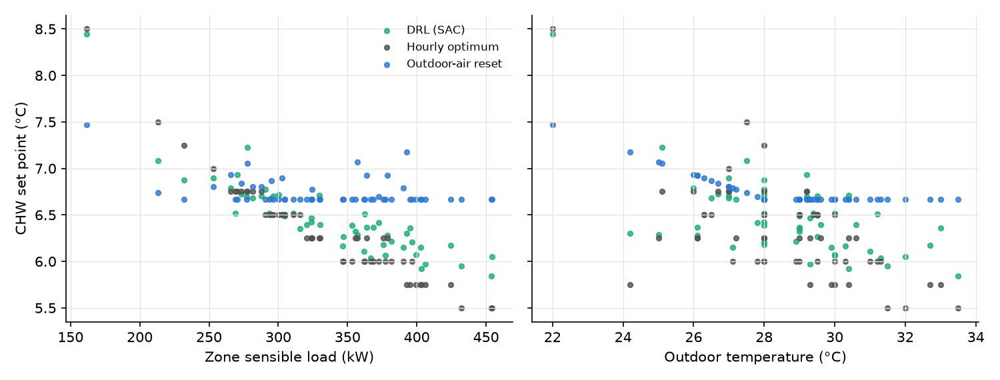
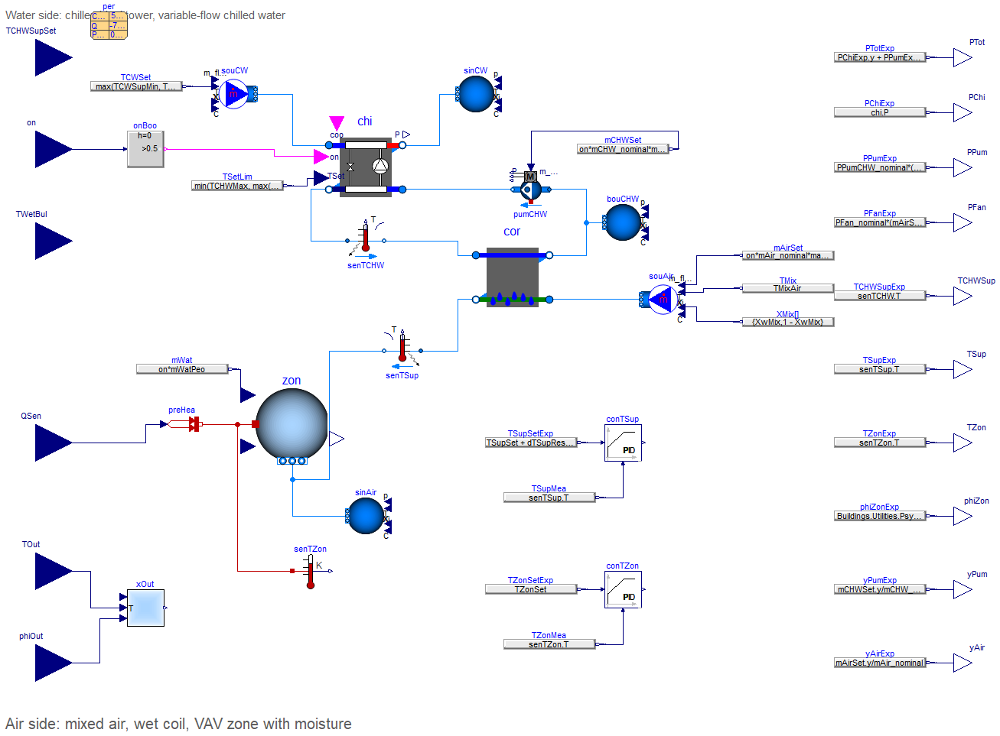
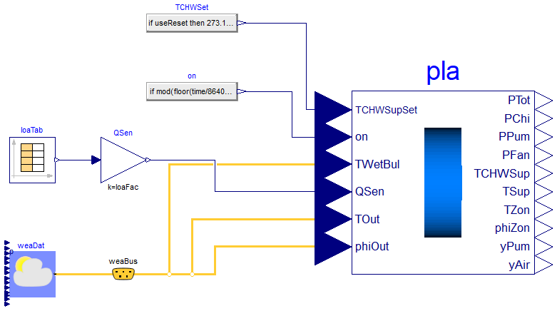
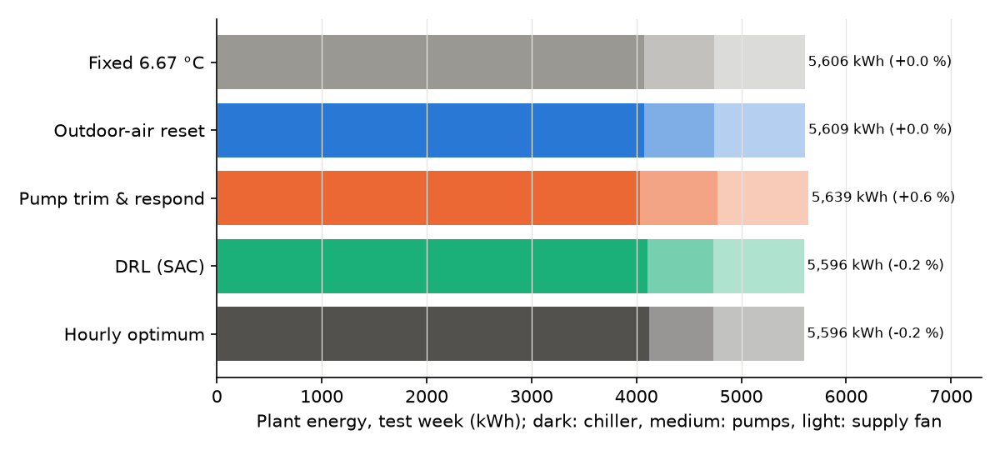
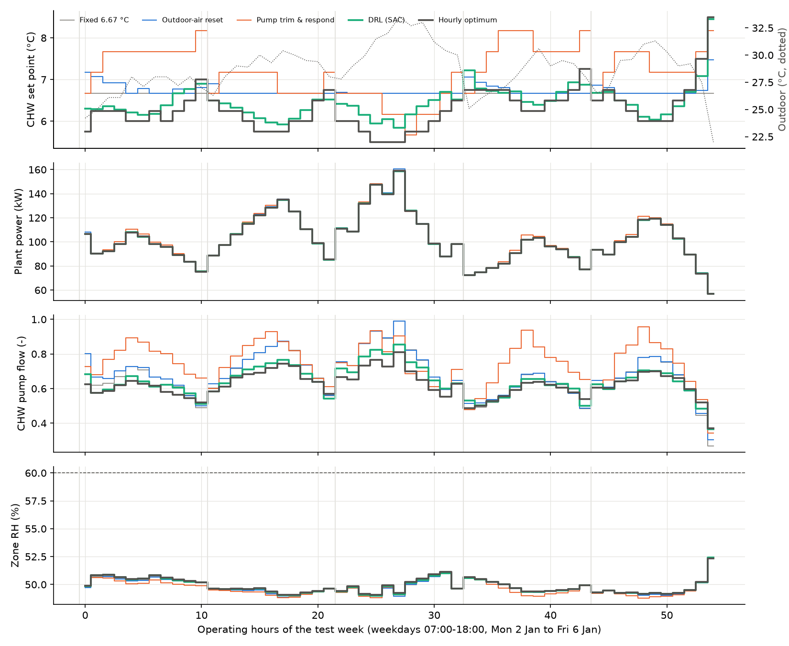
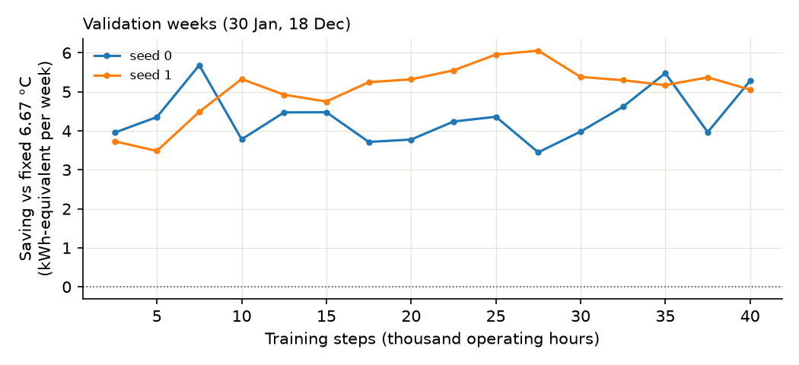

# Case 03 — Chilled water supply temperature reset with an AHU coil and humidity

**Raise the chilled water temperature to save chiller energy, the textbook says. Is it true here?**
One chiller serves the wet cooling coil of an air handling unit (AHU), which supplies a
humid Brisbane office zone through a variable air volume (VAV) system. Every hour a soft
actor-critic (SAC) agent sets the chilled water supply temperature between 5.5 and
11 °C. It is trained **directly on the Dymola FMU** and judged against two common reset
rules and an hourly brute-force optimum computed on the same FMU.

The result goes against the textbook. Warmer chilled water does make the chiller more
efficient, by about 3 % per K. But the coil then needs more water, and once the pump
reaches full speed it needs more air, and pump and fan power grow with the cube of flow.
On this plant both reset rules use **more** energy than a fixed 6.67 °C set point. The
agent learns the opposite strategy: it **lowers** the set point to about 6 °C at high load
and raises it only at part load. That matches the hourly optimum hour by hour and saves
**0.18 %**, which is all there is to save.



---

## 1. Problem

| | |
|---|---|
| Zone | 5 250 m² Brisbane office zone, sensible gains from the Case 02 load profile × 0.35 (peak 470 kW), 350 occupants (45 W latent each), 4.2 kg/s outdoor air; occupied on weekdays 07:00–18:00 |
| Chiller | One York YS 781 kW screw chiller (`ElectricEIR`, COP 5.42); condenser water from an ideal cooling tower at wet bulb + 4 K (at least 18 °C), so the tower fan is not modelled |
| Chilled water | Variable-speed pump, 28 kg/s and 12 kW at design, power cubic in flow, 10 % minimum flow; constant-speed condenser water pump (8.1 kW) |
| AHU | Wet cooling coil (`WetCoilEffectivenessNTU`, 800 kW design), VAV supply fan 45 kg/s and 55 kW at design (cubic), 30 % minimum air flow |
| Local loops (PI, in Modelica) | The zone controller first lowers the supply air set point from 20 to 13 °C, then raises the air flow from 30 to 100 %, to hold 24 °C. The chilled water flow is modulated to hold the supply air set point |
| Comfort limits | Zone relative humidity ≤ 60 %, zone temperature ≤ 24.5 °C, with penalties of 100 kWh per unit of RH·h and 20 kWh per K·h above them |
| Climate | Brisbane Airport TMYx 2011–2025 (dry bulb, relative humidity, wet bulb) |
| Test week | 2–8 January (55 operating hours) |
| Validation weeks | 30 January and 18 December |
| Training | The other 18 summer weeks (November to March), load randomly scaled by ±15 % |

**Baselines**

* *Fixed 6.67 °C* — the chiller's rated leaving temperature.
* *Outdoor-air reset* — 6.67 °C above a high outdoor temperature, rising linearly to a
  higher set point below a low one. The three parameters were chosen by grid search on
  the training weeks: 8 °C at 18 °C outdoor and below, 6.67 °C at 28 °C and above.
* *Pump trim & respond* — every hour the set point goes down 0.5 K when the chilled
  water pump runs above 90 % or the zone RH exceeds 58 %, and up 0.5 K when the pump runs
  below 70 %. This is a simplified hourly version of the pump-speed reset in ASHRAE
  Guideline 36.
* *Hourly optimum* — for every operating hour, a second FMU instance replays the week up
  to that hour with the set points already chosen, then simulates the hour once for each
  candidate set point (5.5–11 °C in 0.25 K steps). The cheapest candidate is kept. The
  zone has little thermal memory, so this greedy choice is a near-optimal reference on
  the FMU itself.

## 2. Modelica model

| `HVACDRL.Case03.CoilPlant` (exported as FMU) | `HVACDRL.Case03.CoilPlantBrisbane` (weather, loads, fixed or reset set point) |
|---|---|
|  |  |

**Inputs**
* Chilled water set point
* Plant on/off
* Wet bulb
* Zone sensible gain
* Outdoor temperature and relative humidity

**Outputs**
* Total, chiller, pump and fan power
* Chilled water and supply air temperatures
* Zone temperature and relative humidity
* Pump and air flow fractions

**Air side.** The mixed air is computed from the outdoor air flow and the zone return
air. It passes the wet coil (which also dehumidifies) and enters a well-mixed zone volume
with moisture. The zone's sensible heat capacity is raised 5× for furniture.

**FMU check.** With the fixed set point, the test week uses:

| Simulation | Energy (kWh) |
|---|---:|
| FMU from Python, inputs changed every hour | 5 606 |
| Dymola, continuous inputs | 5 574 |

The difference is 0.6 %. One operating hour of the two FMU instances (agent and
reference) takes about 5 ms, including the off hours in between.

## 3. RL formulation

| | |
|---|---|
| Plant in the loop | The Dymola FMU (FMI 2.0 co-simulation) via fmpy, 10 min communication step |
| Decision step | 1 h, only operating hours (55 per week) |
| Action (1, continuous) | Chilled water set point 5.5–11 °C |
| Observation (14) | Hour of day (sin/cos); load now and in 1 h; outdoor temperature, relative humidity and wet bulb; zone temperature and RH, supply air temperature, pump and air flow fractions at the end of the previous hour; previous set point; time left in the week |
| Reward | −[(energy + comfort penalties) − (the same for a second FMU running 6.67 °C in the same hour)] / 2 kWh |
| Algorithm | SAC (Stable-Baselines3), γ = 0.9, 40 000 steps, 2 seeds |
| Training time | 9 min on a laptop CPU (both seeds in parallel) |

**Why the reward uses a reference FMU.** A second instance of the FMU runs the fixed
6.67 °C set point alongside the agent's plant. Its cost depends only on load and weather,
so subtracting it does not change the optimal policy. It removes the 60–160 kWh hourly
swings driven by the load, which are much larger than the few tenths of a kWh the set
point changes.

## 4. Results (test week, 2–8 January, all on the FMU)



| Controller | Energy (kWh) | vs fixed | Chiller (kWh) | Pumps (kWh) | Supply fan (kWh) | Mean set point (°C) | Max zone RH |
|---|---:|---:|---:|---:|---:|---:|---:|
| Fixed 6.67 °C | 5 606 | — | 4 075 | 668 | 863 | 6.67 | 52 % |
| Outdoor-air reset (tuned) | 5 609 | +0.05 % | 4 071 | 675 | 864 | 6.75 | 52 % |
| Pump trim & respond | 5 639 | +0.59 % | 4 035 | 741 | 863 | 7.22 | 52 % |
| **DRL (SAC)** | **5 596** | **−0.18 %** | 4 103 | 630 | 863 | 6.46 | 52 % |
| Hourly optimum | 5 596 | −0.18 % | 4 121 | 612 | 863 | 6.30 | 52 % |

The two training seeds reach 5 594 and 5 596 kWh. No controller exceeds 24.5 °C or 60 %
RH in any operating hour.



**Why warmer is not better here.** At the design chilled water flow the coil holds 13 °C
supply air at full load with some margin. Raising the set point by 1 K saves about 3 % of
chiller power, or 3–4 kW at 400 kW of load. But the coil then needs more
water, and pump power grows with the cube of flow.

Here is one hour at peak load (Tuesday 12:00), simulated from the same state:

| Set point | Total (kW) | Chiller (kW) | Pumps (kW) | Fan (kW) | Supply air |
|---|---:|---:|---:|---:|---:|
| 5.5 °C | 128.3 | 90.4 | 12.0 | 25.8 | 13.0 °C |
| 6.67 °C | 129.1 | 87.9 | 15.3 | 26.0 | 13.0 °C |
| 8 °C | 133.8 | 84.2 | 20.1 | 29.5 | 13.5 °C |
| 10 °C | 147.6 | 77.0 | 20.1 | 50.5 | 15.3 °C |

At 8 °C the pump is at full speed and the supply air drifts above 13 °C, so the zone
controller raises the air flow and the fan, also cubic, takes over the losses. The best
set point therefore falls as the load rises: about 7.75 °C below 250 kW of load, 6.3 °C at
300–350 kW and 5.6 °C above 400 kW.

The outdoor-air reset follows outdoor temperature, which tracks the load only loosely.
The pump trim & respond raises the set point until the pump is busy, which is exactly
where the pump energy starts to dominate.

**What the agent learned.** Without being told about the coil or the pump curve, it lowers
the set point as the load rises, from about 7.5 °C at low load to 5.9–6.1 °C at peak. Over the week it
comes within 0.4 kWh of the hourly optimum, slightly below it, because the optimum
chooses greedily one hour at a time. On the validation weeks the
final agents save about 6 kWh per week relative to the fixed set point.



## 5. How to use

```bash
pip install -r ../../requirements.txt

# Run the trained agent (or a rule) on the plant FMU for one week
python run_policy.py                      # SAC, test week
python run_policy.py --policy fixed       # 6.67 degC
python run_policy.py --policy oa          # outdoor-air reset
python run_policy.py --policy tr          # pump-speed trim & respond
python run_policy.py --start-day 29       # another week (day of year of a Monday)

# Train your own agent on the FMU (about 10 min per seed on a laptop CPU)
python train.py --steps 40000 --seed 0
```

The FMU contains Windows 64-bit binaries; this case has no Python approximation of the
plant.

| File | Content |
|---|---|
| `config.py` | Scenario, comfort limits and reward settings |
| `env.py` | Gymnasium environment around two FMU instances (agent and reference) |
| `rules.py` | Fixed, outdoor-air reset and trim & respond rules; episode runner and KPIs |
| `oracle.py` | Hourly brute-force optimum by replay on the FMU |
| `train.py` | SAC training template |
| `run_policy.py` | Run a trained policy or a rule on the FMU and print KPIs |
| `results/` | Trained SAC models (2 seeds), KPIs, hourly trajectories, figures |
| `fmu/Case03_CoilPlant.fmu` | Plant, coil and zone as FMU (FMI 2.0 co-simulation, win64, Dymola 2023) |

## 6. Limitations

* **Chiller curves.** The York curves are calibrated for 4.4–8.9 °C leaving water, so
  set points above 8.9 °C extrapolate them. The optimum stays within 5.5–8.5 °C. At the
  highest loads it sits at the 5.5 °C lower bound of the action range, so a slightly
  lower set point might save a little more.
* **Coil sizing decides the answer.** With a larger coil, or a plant whose pumping energy
  is a smaller share, warmer chilled water would pay off more often. The result here holds
  for this plant, not for chilled water reset in general.
* **No tower fan.** The ideal cooling tower leaves out the tower fan, and with it the effect
  of the set point on condenser-side energy.
* **Humidity never binds.** Holding 13 °C supply air keeps the zone below 52 % RH in
  every controller. The humidity penalty is never active in the test week.
* **Forecasts and scope.** The agent sees the current and next hour's load. One test week.
* **FMU state save/restore.** `fmi2GetFMUstate`/`fmi2SetFMUstate` would make the optimum
  faster. In this Dymola FMU, a restored state no longer reacted correctly to later input
  changes (the chiller stayed off), so the benchmark replays the week instead.
