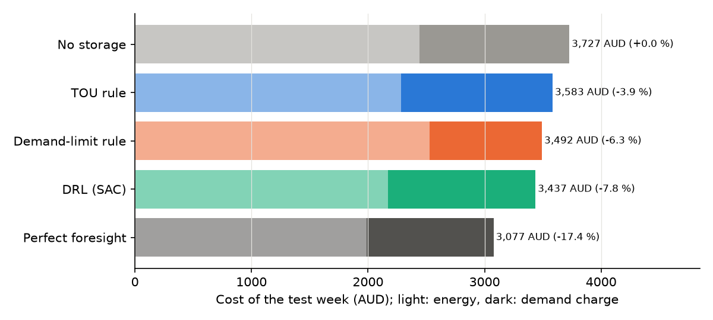
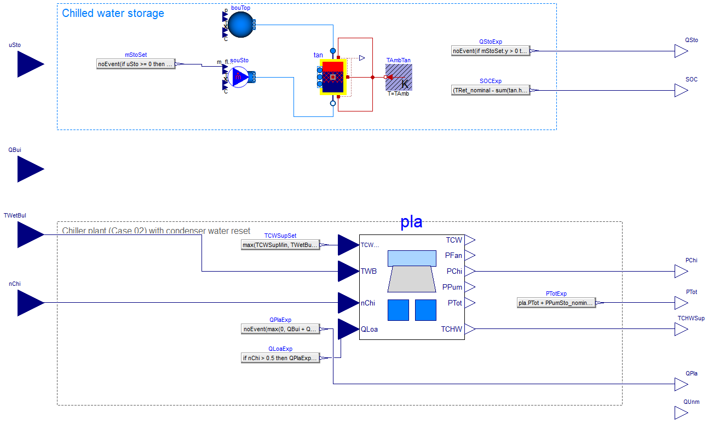
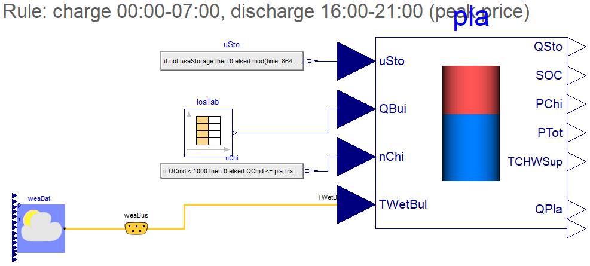
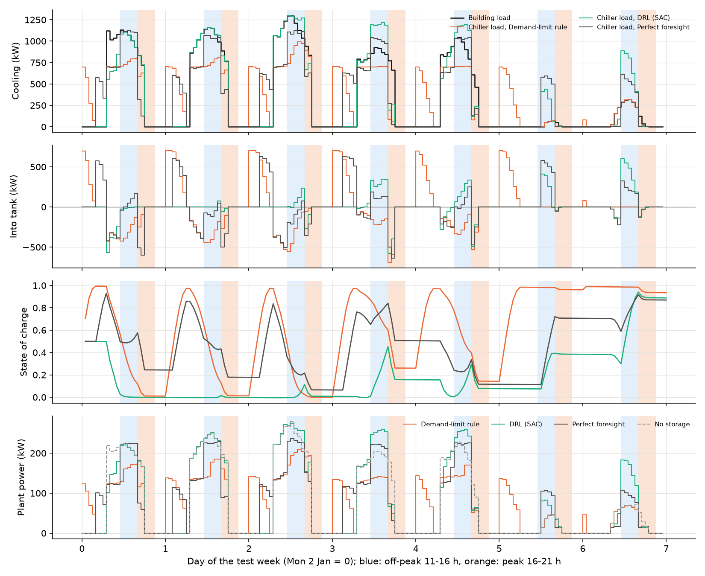
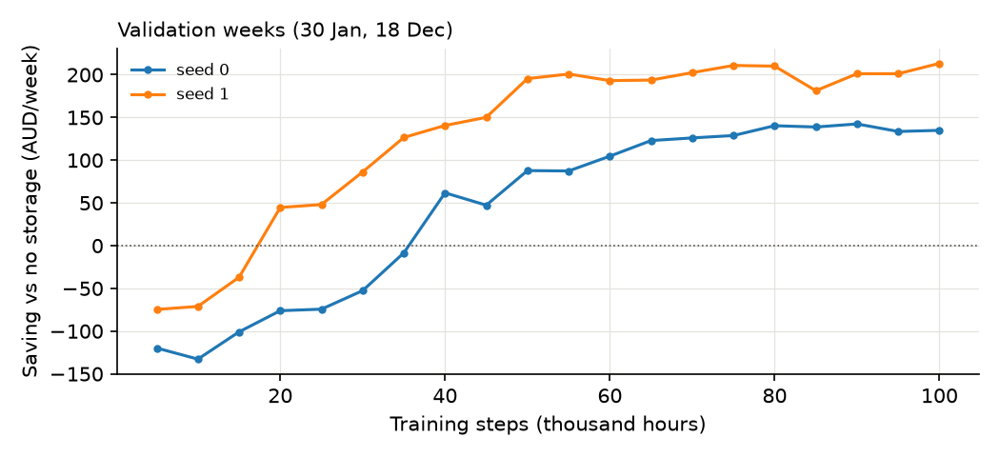

# Case 04 — Chilled water storage under time-of-use prices and a demand charge

**When there is something to store, does reinforcement learning beat the rules?**
The chiller plant of [Case 02](../02-chiller-plant/) gets a 400 m³ stratified chilled
water tank (about 3.4 MWh). Every hour a soft actor-critic (SAC) agent decides how fast
to charge or discharge it. The electricity bill has a time-of-use energy price and a
demand charge on the highest hourly power. The agent is trained **directly on the Dymola
FMU**, so every step simulates the stratified tank and the plant in Modelica.

Over the test week the agent cuts the cost by **7.8 %** compared with no storage. That
beats a time-of-use rule (−3.9 %) and a demand-limiting rule tuned on the training
weeks (−6.3 %). It finds a strategy neither rule uses: it charges in the cheap midday
window (11:00–16:00, when rooftop solar depresses prices) and discharges in the evening
peak. A perfect-foresight schedule saves **17.4 %**, so the agent captures
about 45 % of what is possible. The part it misses is the demand charge: it barely
lowers the weekly peak.



---

## 1. Problem

| | |
|---|---|
| Plant | Case 02: 2 × York YS 781 kW screw chillers, one variable-speed cooling tower, constant-speed pumps; condenser water reset to wet bulb + 4 K |
| Storage | 400 m³ stratified tank (`Buildings.Fluid.Storage.Stratified`, 16 layers, 10 m high, 0.2 m insulation), 6.67/14 °C, about 3 390 kWh; charge and discharge up to 700 kW; tank pump 5 kW at full flow |
| Building | 15 000 m² Brisbane office, peak cooling load 1.35 MW, occupied on weekdays 07:00–18:00 |
| Energy price | Peak 16:00–21:00 0.48 AUD/kWh, off-peak 11:00–16:00 0.08 AUD/kWh, shoulder (all other hours) 0.26 AUD/kWh |
| Demand charge | 20 AUD per kW of the highest hourly mean plant power in the month (illustrative), pro-rated to 4.6 AUD/kW for a one-week episode |
| Stored energy | The change in state of charge over the week is credited at the shoulder price and a plant COP of 5, so no controller gains by emptying the tank |
| Test week | 2–8 January (highest weekly load of the summer) |
| Validation weeks | 30 January and 18 December |
| Training | The other summer weeks (November to March), load randomly scaled by ±15 %, initial state of charge 0.2–0.8 |

**Baselines**

* *No storage* — the tank is idle.
* *TOU rule* — charge at full rate from midnight to 07:00 (until 97 % full); discharge at
  full rate from 16:00 to 21:00 while the building has a load.
* *Demand-limit rule* — charge after midnight as above; during the day the tank carries
  the load above a fixed limit, and everything it can in the peak price period. The
  limit (700 kW of cooling) was chosen by grid search over 400–1 200 kW on the training
  weeks.
* *Perfect foresight* — dynamic programming over the state of charge (25 kWh grid) on a
  quasi-steady Python approximation of the plant (`plant_twin.py`), knowing the whole
  week's load and weather. The demand charge is handled by sweeping a power cap. The
  resulting hourly schedule is then run on the FMU like any other controller. It is a
  near-optimal reference, not the exact optimum of the FMU.

## 2. Modelica model

| `HVACDRL.Case04.StoragePlant` (exported as FMU) | `HVACDRL.Case04.StoragePlantBrisbane` (weather, load, TOU rule) |
|---|---|
|  |  |

**Inputs.**
* Storage command `uSto` (−1 to 1).
* Building load.
* Number of chillers.
* Wet-bulb temperature.

**Outputs.**
* Plant power and chiller power.
* Heat flow into the tank.
* State of charge, from the layer temperatures.
* Chiller load.
* Chilled water supply temperature.
* Unserved cooling.

**How the tank works.**
* *Charging.* Cold water from the chillers enters the bottom of the tank and warm water
  leaves the top. The extra chiller load is the flow times the temperature difference
  between the top layer and the supply. It therefore falls as the thermocline reaches
  the top, so the tank charges more slowly when it is nearly full.
* *Discharging.* Cold water leaves the bottom and carries part of the building load. The
  chillers carry the rest.

**Staging rule.** The number of chillers follows the staging rule of Case 02, applied to
the expected chiller load. One chiller always stays on as back-up while the building has
a load. Staging is set outside the model and passed in as an FMU input, because a
staging rule inside the FMU did not react to the hourly input changes; see §6.

**FMU check.**
* *Speed.* One hourly step takes 2 ms, so 100 000 training hours of plant simulation
  take about 4 min.
* *Agreement with the quasi-steady approximation.* With the TOU rule over the test week,
  the FMU costs 3 583 AUD and the approximation 3 468 AUD (3 % apart). Most of the gap
  comes from charging slowing down near a full tank, which the ideal-stratification
  approximation does not have.

## 3. RL formulation

| | |
|---|---|
| Plant in the loop | The Dymola FMU (FMI 2.0 co-simulation) via fmpy, 10 min communication step |
| Decision step | 1 h, all 168 hours of the week |
| Action (1, continuous) | Storage command −1 (full discharge) to +1 (full charge); charging is limited to the spare chiller capacity, discharging to the building load |
| Observation (17) | State of charge; load now and in 1–3 h; load left today and in the next 24 h; price now and next hour; hours to the peak period; hour of day (sin/cos); peak power so far this week; plant power without storage now; highest power without storage in the next 12 h relative to the peak so far; wet bulb; time left in the week |
| Reward | −[(energy cost + increase of the weekly peak × demand rate) − (the same for no storage) + penalties] / 5 AUD; stored-energy credit at the end of the week |
| Penalties | 1 AUD per kWh of unserved cooling, 20 AUD per K·h of chilled water above 7.5 °C |
| Algorithm | SAC (Stable-Baselines3), γ = 0.98, 256 × 256 networks, 100 000 steps, 2 seeds |
| Training time | 25 min on a laptop CPU (both seeds in parallel) |

**Why subtract the cost without storage.** The cost without storage depends only on the
load and weather. The agent cannot influence either, so subtracting it does not change
the optimal policy. It removes the large, load-driven swings in the reward, so the agent
sees what its own decisions change.

## 4. Results (test week, 2–8 January, all on the FMU)

| Controller | Total (AUD) | vs no storage | Energy (AUD) | Demand (AUD) | Peak (kW) | Plant energy (kWh) | Tank discharged (kWh) | Unserved |
|---|---:|---:|---:|---:|---:|---:|---:|---:|
| No storage | 3 727 | — | 2 435 | 1 284 | 279 | 12 009 | 0 | 0 |
| TOU rule | 3 583 | −3.9 % | 2 360 | 1 299 | 282 | 12 777 | 6 823 | 0 |
| Demand-limit rule | 3 492 | −6.3 % | 2 607 | 962 | 209 | 12 136 | 15 265 | 0 |
| **DRL (SAC)** | **3 437** | **−7.8 %** | 2 238 | 1 267 | 275 | 12 390 | 4 798 | 0 |
| Perfect foresight | 3 077 | −17.4 % | 2 054 | 1 088 | 236 | 11 631 | 11 498 | 0 |

The total also subtracts the stored-energy credit, which is 66–77 AUD for the
controllers that use the tank. The two training seeds reach 3 437 and 3 576 AUD
(−7.8 % and −4.0 %). No controller leaves any cooling unserved, and the chilled water
never rises above 6.7 °C.



**What the agent learned.** It uses the cheapest energy of the day. It empties the tank
on Monday morning, then charges it in the midday off-peak window, when power costs
0.08 AUD/kWh instead of 0.26 at night, and discharges it from 16:00. Its energy cost is
the lowest of all controllers except perfect foresight. Neither rule does this: the TOU
rule charges at night at the shoulder price, so its savings in the peak period are
mostly offset.

**What it did not learn.** It does not limit the peak. Its weekly peak, 275 kW, is
about the same as without storage. The demand-limit rule lowers the peak to 209 kW but
pays for it with more expensive energy. Perfect foresight does both: it charges at
midday, discharges in the evening and holds the peak at 236 kW. The demand charge depends
on a single hour of the week. A decision on Monday affects the bill only if that hour
turns out to be the peak days later, and SAC with one-hour steps does not discover this
link in 100 000 steps. In total the agent captures 45 % of the saving that perfect
foresight shows is possible.



## 5. How to use

```bash
pip install -r ../../requirements.txt

# Run the trained agent (or a rule) on the plant FMU for one week
python run_policy.py                      # SAC, test week
python run_policy.py --policy tou         # charge 0-7 h, discharge 16-21 h
python run_policy.py --policy demand --target 700
python run_policy.py --policy none
python run_policy.py --start-day 29       # another week (day of year of a Monday)

# Train your own agent on the FMU (about 25 min per seed on a laptop CPU)
python train.py --steps 100000 --seed 0
```

The FMU contains Windows 64-bit binaries. On other platforms set
`HVACDRL_PLANT=twin` to use the quasi-steady Python approximation instead.

| File | Content |
|---|---|
| `config.py` | Plant, tank, tariff, scenario and reward settings |
| `env.py` | Gymnasium environment around the FMU (staging rule, reward) |
| `rules.py` | TOU and demand-limit rules, episode runner and KPIs |
| `oracle.py` | Perfect-foresight benchmark (dynamic programming on the twin) |
| `plant_twin.py` | Quasi-steady approximation of plant and tank (reward reference, benchmark, non-Windows runs) |
| `train.py` | SAC training template |
| `run_policy.py` | Run a trained policy or a rule on the FMU and print KPIs |
| `results/` | Trained SAC models (2 seeds), KPIs, hourly trajectories, figures |
| `fmu/Case04_StoragePlant.fmu` | Plant and tank as FMU (FMI 2.0 co-simulation, win64, Dymola 2023) |

## 6. Notes and limitations

* **Demand charge.** The monthly demand charge is pro-rated to one week. A real
  controller would have to protect a peak set earlier in the month, which makes the
  credit assignment even harder.
* **Forecasts.** The agent and the rules see perfect load forecasts (up to 24 h) and
  the current wet bulb. Perfect foresight knows the whole week.
* **Benchmark.** The perfect-foresight schedule is computed on the quasi-steady
  approximation with ideal stratification. On the FMU it costs 6 % more than the
  approximation predicts, so the true optimum of the FMU is somewhat lower than 3 077 AUD.
* **Staging outside the FMU.** In the Dymola co-simulation FMU, an input change at a
  communication point did not trigger an event. Relations that depend on the inputs
  through other variables, such as a staging threshold on the chiller load, therefore
  kept their previous value until the next event. For the same reason, the environment
  initialises the FMU at the first step with the first action as input.
* **Scope.** One building, one tariff, one test week.
