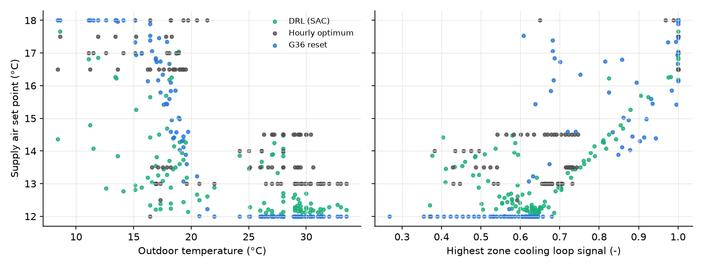
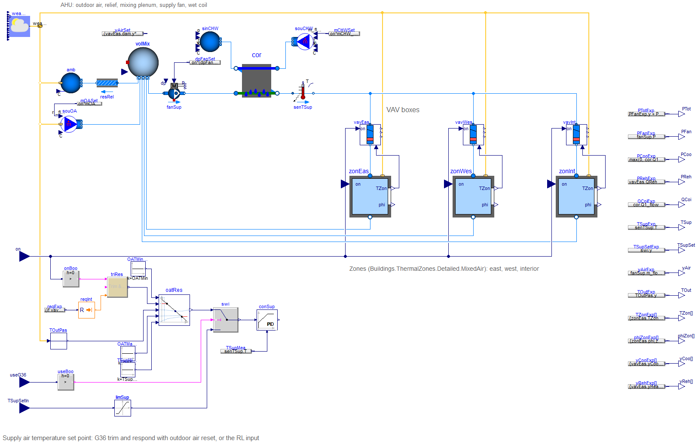
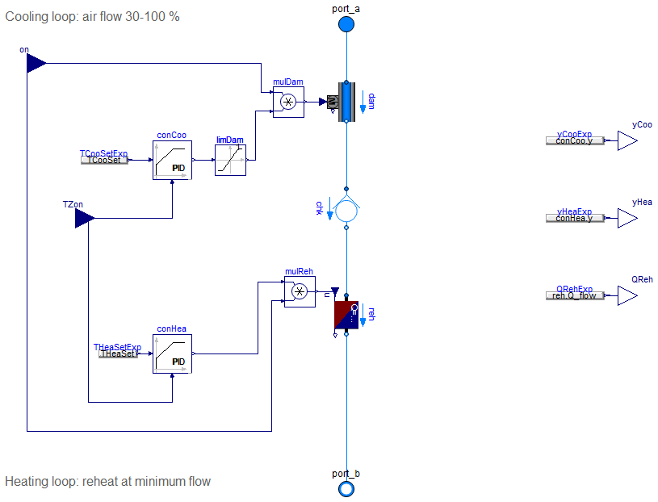
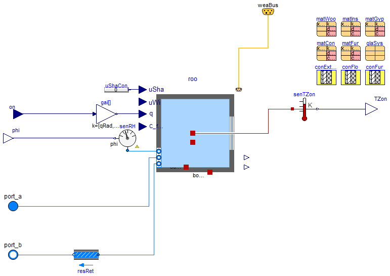
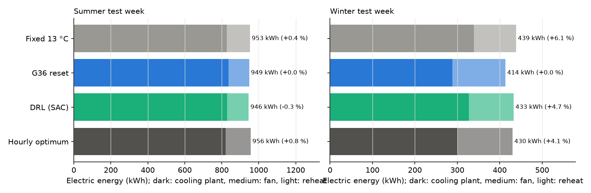
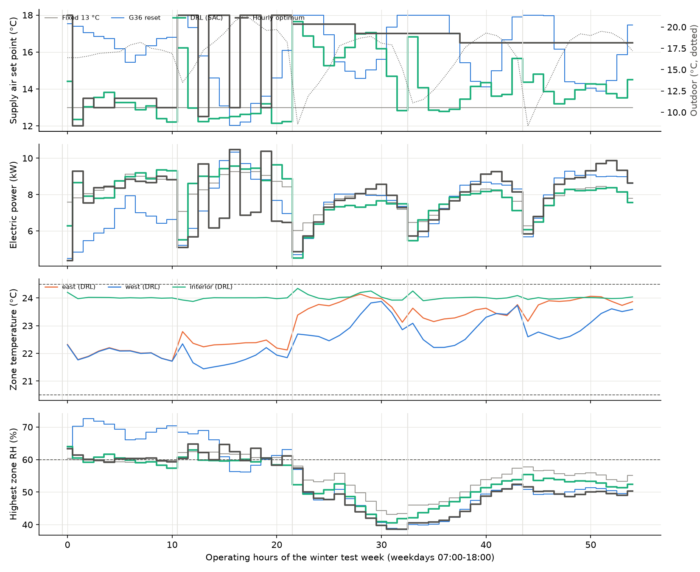
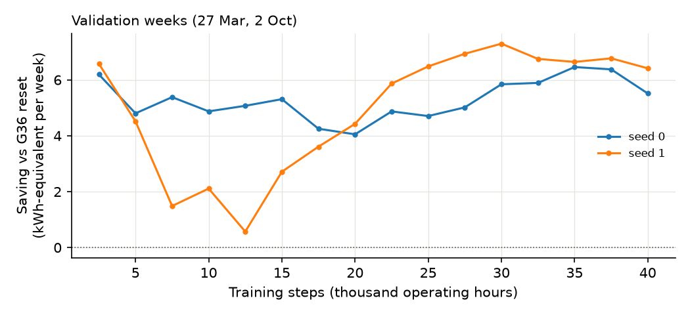

# Case 05 — Supply air temperature reset in a VAV system: DRL vs ASHRAE Guideline 36

**Guideline 36 resets the supply air temperature to save energy. In a humid subtropical
climate, what does it cost in comfort, and can an agent do better?**
An air handling unit (AHU) with a wet cooling coil serves three Brisbane office zones
through VAV boxes with electric reheat. Every operating hour a soft actor-critic (SAC)
agent sets the supply air temperature between 12 and 18 °C. It is trained **directly on
the FMU**. It is compared with a fixed 13 °C set point, with the ASHRAE Guideline 36 (G36)
trim-and-respond reset, and with an hourly search on the same FMU.

The answer depends on the season. In summer, G36 holds the lowest set point all week
because it is always warmer than 21 °C outdoors. All controllers then lie within 1 % of
each other, and there is nothing to gain. In winter, G36 uses the least energy, but it
raises the supply air to about 16 °C on average. The coil then removes too little
moisture: zone humidity reaches 73 % and the interior zone overheats in 12 hours. The
agent uses 4.7 % more energy than G36 but 1.3 % less than the fixed 13 °C. It keeps the
zones within 24.5 °C and holds humidity close to 60 %. A well-chosen constant set point
gets most of the way, so the headroom for learning stays small.



---

## 1. Problem

| | |
|---|---|
| Zones | Three zones built on `Buildings.ThermalZones.Detailed.MixedAir`: east and west perimeter zones (300 m² each, 30 m facade, 40 % double glazing) and an interior zone (600 m²). Each has a concrete floor slab and furniture mass; other surfaces are adiabatic |
| Gains | 25 W/m² sensible (12 radiant, 13 convective) plus 4.5 W/m² latent while occupied (weekdays 07:00–18:00); solar gains from the weather file |
| VAV boxes | Pressure-independent damper, backdraft damper and electric reheat (12, 12 and 8 kW). The cooling loop sets the air flow between 30 % and 100 % above 24 °C; the heating loop modulates the reheat below 21 °C |
| AHU | 1.44 kg/s outdoor air (no economizer), mixing plenum with relief, blow-through supply fan (6 kg/s, 700 Pa at design, pressure rise following the flow demand of the boxes), wet coil (`WetCoilEffectivenessNTU`, 120 kW). The chilled water flow (6.67 °C supply) is modulated to hold the supply air set point |
| Energy | Supply fan (fan model), cooling plant = coil load / 4.5, electric reheat |
| Comfort limits (occupied hours) | Zone temperature 20.5–24.5 °C, zone relative humidity ≤ 60 %. Penalties: 10 kWh per K·h and 50 kWh per unit of RH·h, summed over the zones |
| Set-point changes | 0.3 kWh per K of change from the previous operating hour (see section 3) |
| Climate | Brisbane Airport TMYx 2011–2025, read inside the FMU |
| Test weeks | Summer, 2–8 January; winter, 3–9 July (55 operating hours each) |
| Validation weeks | 27 March and 2 October |
| Training | The other 47 weeks of the year |

**Baselines**

* *Fixed 13 °C* — a constant supply air set point.
* *G36 reset* — ASHRAE Guideline 36, section 5.16.2, implemented with
  `Buildings.Controls.OBC.ASHRAE.G36.Generic.TrimAndRespond`. During occupied hours T is
  reset between 12 and 18 °C every 2 min: +0.1 K per step without requests, −0.2 K per
  zone cooling request (cooling loop above 95 %), at most −0.6 K, ignoring one request.
  The set point is TSupMin (12 °C) above 21 °C outdoors, T below 16 °C, and interpolated
  in between.
* *Hourly search* — for every operating hour, the FMU state is saved, the hour is
  simulated once for each candidate set point (12–18 °C in 0.5 K steps), and the cheapest
  candidate is kept. This choice is greedy: it ignores the effect on later hours through
  the zone thermal mass and humidity. It is therefore a reference, not an optimum.

## 2. Modelica model

| `HVACDRL.Case05.VAVSystem` (exported as FMU) |
|---|
|  |

| `HVACDRL.Case05.VAVBox` | `HVACDRL.Case05.Zone` |
|---|---|
|  |  |

`HVACDRL.Case05.VAVSystemBrisbane` runs the system with the office schedule and either
the G36 reset or the fixed set point.

**Inputs**
* Supply air set point
* G36 or input selection
* AHU on/off

**Outputs**
* Total, fan, cooling-plant and reheat power
* Coil load
* Supply air temperature and active set point
* Air flow fraction
* Outdoor temperature
* For each zone: temperature, relative humidity, and cooling and heating loop signals

The weather is read inside the FMU, because the rooms need the full weather bus (solar
radiation on the facades).

**FMU check.** On the summer test week:

| Simulation | Fixed 13 °C (kWh) | G36 (kWh) |
|---|---:|---:|
| FMU from Python, inputs changed every hour | 953 | 949 |
| Modelica simulation, continuous schedule | 940 | 936 |

The FMU runs about 1.3 % higher. One training step takes about 34 ms: one operating
hour of the two FMU instances (agent and reference), plus the off hours in between.

## 3. RL formulation

| | |
|---|---|
| Plant in the loop | The plant FMU (FMI 2.0 co-simulation) via fmpy, 10 min communication step |
| Decision step | 1 h, only operating hours (55 per week) |
| Action (1, continuous) | Supply air set point 12–18 °C |
| Observation (19) | Hour of day (sin/cos); outdoor temperature and its change over the next hour; global horizontal radiation now and in 1 h; outdoor relative humidity; at the end of the previous hour: the three zone temperatures, the highest zone RH, the three cooling loop signals, the highest reheat signal, air flow fraction and supply air temperature; previous set point; time left in the week |
| Reward | −[(energy + comfort penalties + set-point change penalty) − (the same for a second FMU running G36 in the same hour)] / 0.5 kWh |
| Algorithm | SAC (Stable-Baselines3), γ = 0.95, 40 000 steps, 2 seeds |
| Training time | 21 min on a laptop CPU (both seeds in parallel) |

**Why a set-point change penalty.** Without it, both the agent and the hourly search
learned to switch between 12 and 18 °C from one hour to the next in humid weeks. One
hour of cold air dried the zones, one hour of warm air saved fan and coil energy, and
the hourly mean humidity stayed just at 60 %. This exploits the hourly averaging of the
comfort terms and would not be accepted in operation. The penalty of 0.3 kWh per K
applies to every controller, including G36 and the reference.

## 4. Results (all on the FMU)



**Summer test week (2–8 January)**

| Controller | Energy (kWh) | vs G36 | Cooling (kWh) | Fan (kWh) | Mean set point (°C) | Hours RH > 60 % | Hours > 24.5 °C |
|---|---:|---:|---:|---:|---:|---:|---:|
| Fixed 13 °C | 953 | +0.4 % | 828 | 125 | 13.0 | 0 | 0 |
| G36 reset | 949 | — | 836 | 113 | 12.0 | 0 | 0 |
| **DRL (SAC)** | **946** | **−0.3 %** | 828 | 117 | 12.6 | 1 | 0 |
| Hourly search | 956 | +0.8 % | 822 | 135 | 13.7 | 4 | 0 |

**Winter test week (3–9 July)**

| Controller | Energy (kWh) | vs G36 | Cooling (kWh) | Fan (kWh) | Mean set point (°C) | Hours RH > 60 % | Max RH | Hours > 24.5 °C | Cost incl. penalties (kWh) |
|---|---:|---:|---:|---:|---:|---:|---:|---:|---:|
| Fixed 13 °C | 439 | +6.1 % | 339 | 100 | 13.0 | 12 | 62 % | 0 | 448 |
| G36 reset | 414 | — | 288 | 125 | 16.0 | 19 | 73 % | 12 | 622 |
| **DRL (SAC)** | **433** | **+4.7 %** | 327 | 106 | 14.0 | 9 | 64 % | 0 | 453 |
| Hourly search | 430 | +4.1 % | 301 | 130 | 16.1 | 15 | 65 % | 4 | 465 |

No controller uses reheat in either week. The second training seed reaches 949 kWh
(summer) and 431 kWh (winter).



**Summer: nothing to gain.** Outdoors it is always above 21 °C during occupied hours, so
G36 holds 12 °C all week. A warmer supply air would cut the coil load slightly, but the
fan has to move more air. Over the week these two effects nearly cancel. All
controllers lie within 1 %.

**Winter: energy against humidity.** The July mornings are mild (16.7 °C on average) but
humid (69 % RH). G36 sees few cooling requests and outdoor temperatures below 21 °C,
so it raises the supply air up to 18 °C. That saves cooling energy, but the coil then
hardly dehumidifies. On the first two days the zones stay between 66 and 73 % RH. The
interior zone, which has no envelope losses and needs cold air all year, rises above
24.5 °C in 12 hours. The fixed 13 °C keeps the air dry but overcools the perimeter zones
on cool days and uses the most energy.

**What the agent learned.** It keeps the supply air near 12–13 °C while the outdoor air
is humid. It raises the set point on dry, mild days, up to about 17 °C, as the zone
cooling loops relax (right-hand panel of the policy figure). Against the fixed set point it
saves 1.3 % energy with similar comfort. Against G36 it spends 4.7 % more energy to
remove most of the humidity and all of the overheating. The greedy hourly search
does worse than the agent in winter: choosing warm air in one hour leaves moist air and
warm mass for the next hours, which the greedy search does not see.

**How large the difference is depends on the penalties.** The cost column adds energy
and comfort penalties; with other weights the ranking between DRL and the fixed set
point could change. Energy and comfort are therefore reported separately.



## 5. How to use

```bash
pip install -r ../../requirements.txt

# Run the trained agent (or a rule) on the plant FMU for one week
python run_policy.py                      # SAC, summer test week
python run_policy.py --policy g36         # ASHRAE G36 reset
python run_policy.py --policy fixed       # 13 degC
python run_policy.py --start-day 183      # winter test week (day of year of a Monday)

# Train your own agent on the FMU (about 20 min per seed on a laptop CPU)
python train.py --steps 40000 --seed 0
```

The FMU contains Windows 64-bit binaries; this case has no Python approximation of the
plant.

| File | Content |
|---|---|
| `config.py` | Scenario, comfort limits and reward settings |
| `env.py` | Gymnasium environment around two FMU instances (agent and G36 reference) |
| `rules.py` | Fixed and G36 rules; episode runner and KPIs |
| `oracle.py` | Hourly search on the FMU (state save/restore) |
| `train.py` | SAC training template |
| `run_policy.py` | Run a trained policy or a rule on the FMU and print KPIs |
| `results/` | Trained SAC models (2 seeds), KPIs, hourly trajectories, figures |
| `fmu/Case05_VAVSystem.fmu` | AHU, VAV boxes and zones as FMU (FMI 2.0 co-simulation, win64) |

## 6. Limitations

* **No economizer and no duct static pressure reset.** The outdoor air flow is fixed at
  the minimum. With an airside economizer, a warmer supply air would often be free in
  winter, and the trade-off would shift. The fan pressure follows the box flow demand
  through a simple quadratic schedule, not the G36 static pressure reset.
* **Cooling plant as a constant COP.** The chilled water plant is reduced to
  coil load / 4.5. Its part-load and chilled water temperature effects (Case 03) are
  not included.
* **G36 parameters at their defaults.** TSupMin, TSupMax and the outdoor air limits
  follow the guideline's typical values. A designer in a humid climate would cap TSupMax
  lower or add a humidity override. G36 then behaves much like the agent.
* **Hourly decisions.** The agent acts once per hour and sees the comfort only as
  hourly means; G36 acts every 2 min.
* **Three zones, two test weeks.** The building is small and simple, and only one summer
  and one winter week are tested.
* **Shutdown transient.** When the AHU stops at 18:00, the solver occasionally fails one
  step. During training this happened once in the 80 000 steps of the two seeds; the episode was truncated
  and the FMU reloaded.
